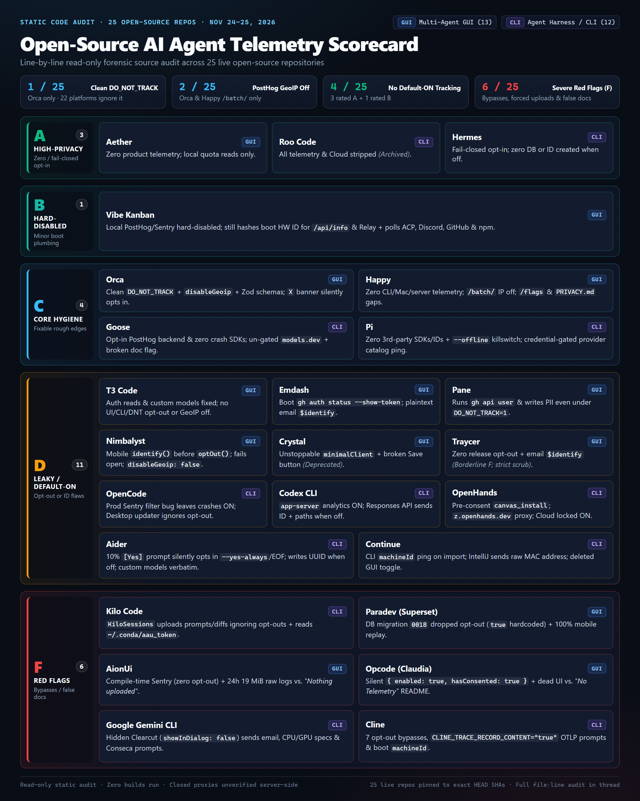

# Open-Source AI Agent Telemetry & Privacy Audit

A read-only, line-by-line static source audit of telemetry, crash reporting, analytics, local credential reads, and privacy claims across **25 open-source AI coding GUIs and agent harnesses** (pinned to exact `HEAD` commits from November 24–25, 2026).

## Quick Navigation

- [**Closed-Source 10-App Sandbox Audit**](./closed-source-report.md) — Live Docker sandbox tests (default cold boot vs. opt-out) across Claude Code, Codex Desktop, Cursor, VS Code, Warp, Obsidian, Discord, Slack, Spotify, and Chrome ([ranked scorecard](./scorecard-closed-4x5.png)).
- [**Full Comparative Forensic Report**](./report.md) — Deep-dive comparison matrix, exact endpoints, data catalogs, policy mismatches, and per-tool opt-out instructions.
- [**Executive Summary**](./summary.md) — Condensed rating matrix and key takeaways.
- [**Per-Platform Audits (`audits/`)**](./audits/) — 25 standalone reports with exact `file:line` source citations.
- [**Commit SHA Manifest**](./repos-manifest.json) — Exact 40-character commit SHAs, licenses, and timestamps audited.
- [**Machine-Readable JSON**](./prescan/all-summaries.json) — Structured 21-field summaries for all 25 repositories.

---

## Plain-English Highlights

Out of **25 open-source platforms**:
- **Only 1 in 25** (`Orca`) cleanly honors the browser/OS `DO_NOT_TRACK` setting (`22` ignore it completely).
- **Only 2 in 25** (`Orca` and `Happy`'s batch endpoint) disable IP/location collection in PostHog.
- **Only 4 in 25** (`Aether`, `Roo Code`, `Hermes`, `Vibe Kanban`) ship without active default-ON analytics or crash tracking.
- **6 in 25** earned an **`F`** for hiding tracking, ignoring user opt-out switches, uploading prompts/logs silently, or making false *"No Telemetry"* / *"Nothing uploaded"* promises.

### Why the 6 `F`-Rated Tools Failed
- **Kilo Code (`F`):** When you sign in, `KiloSessions` automatically uploads your prompts, AI responses, and code diffs to `ingest.kilosessions.ai` **even if you turn off telemetry and session sharing** (contradicting its `PRIVACY.md` policy). When telemetry is on, it also harvests your Anaconda tracking token and links events to your plaintext email.
- **Paradev / Superset (`F`):** Maintainers deleted the desktop app's telemetry opt-out database column, hardcoded *"telemetry enabled"* to always return `true`, and left the UI toggle setter as a fake no-op — while recording **100% of mobile app screens** (`sampleRate: 1`) and firing ad pixels on the website even when you reject cookies.
- **AionUi (`F`):** Sends Sentry crash reports unconditionally (baked in at build time with no user opt-out) and automatically zips up and uploads up to **19 MiB of unredacted logs every 24 hours** — despite 9 translated READMEs claiming *"Nothing is uploaded to any server."*
- **Opcode / Claudia (`F`):** Ships PostHog tracking turned **ON** with fake pre-filled *"user already consented"* flags while the actual consent prompt UI is disconnected dead code — yet `README.md` directly claims *"No Telemetry"* and *"All data stays on your machine."*
- **Google Gemini CLI (`F`):** Turns Google Clearcut telemetry ON by default while **hiding the opt-out setting from `/settings`**, ignores `DO_NOT_TRACK`, and sends your **plaintext Google email**, hardware specs (CPU/RAM/GPU), and some security prompts/tool inputs despite documentation promising zero emails or prompt contents.
- **Cline (`F`):** Default-ON PostHog and telemetry with **7 separate ways it bypasses opt-outs** (including startup rollout pings, feature-flag polling, optional prompt tracing on Cline providers that ignores VS Code's off switch, no CLI opt-out flag, and reading your hardware machine ID unconditionally on launch).

### Cleanest Picks (`A` & `B`) and Strong Middle Tier (`C`)
- **`A` — Aether:** Zero product telemetry, analytics SDKs, crash reporters, or persistent tracking IDs *(notes: automatically reads local Claude/Codex creds strictly to show your local quota meters)*.
- **`A` — Roo Code *(Archived `2026-05-15`)*:** Stripped out all telemetry, PostHog, and Cloud services prior to archiving.
- **`A` — Hermes:** Strictly opt-in across every telemetry/tracing system, never creates tracking databases or install IDs while turned off, and forces third-party `cua-driver` tracking off *(stale FAQ wording doesn't change clean runtime defaults)*.
- **`B` — Vibe Kanban:** Hard-disabled local PostHog and Sentry completely; only drops from `A` because it still generates a hardware-derived ID at boot for `/api/info` & Relay registration and polls public feeds.
- **`C` — Orca, Happy, Goose, Pi:** Each ships strong core privacy engineering (`Orca` honors `DO_NOT_TRACK` + disables GeoIP; `Happy` has zero CLI/Mac/server telemetry and strips IPs in `/batch/`; `Goose` defaults backend PostHog to `false`; `Pi` has zero third-party analytics SDKs and a `--offline` killswitch), held below `B`/`A` by fixable default flags, startup catalog pings, minor pre-opt-out edge beacons, or outdated docs.

### Notable `D`-Tier Findings (Leaky Defaults or Broken Controls)
- **T3 Code *(Live `HEAD`)*:** Improved dramatically from an initial **`F`** (removed Codex/Claude file reads from telemetry and masked custom models), landing at upper-`D` — still lacks an in-app toggle, CLI flag, or `DO_NOT_TRACK` support, creates an `anonymous-id` file even when disabled, and skips PostHog IP suppression.
- **Emdash:** Runs `gh auth status --show-token` on every startup and attaches plaintext email / GitHub username via `$identify` while calling data *"anonymous."*
- **Pane:** Runs `gh api user` and writes GitHub/Git email & name to `config.json` **even when you opt out or set `DO_NOT_TRACK=1`**.
- **OpenCode:** A typo checking `OPENCODE_CHANNEL` instead of `VITE_OPENCODE_CHANNEL` leaves automatic Sentry crash reporting active in production Desktop releases, and the Desktop updater ignores CLI opt-out flags.
- **OpenAI Codex CLI:** Leaves its analytics client enabled inside `app-server` despite `--help` stating otherwise, and still sends persistent `installation_id`, workspace paths, and git remotes on API calls when opted out.
- **OpenHands, Continue, Aider, Nimbalyst, Crystal, Traycer:** Range from ad-blocker-bypass proxies (`z.openhands.dev`) and silent pre-consent pings (`OpenHands`), unconditional startup hardware ID/MAC address pings (`Continue`), broken Analytics Save buttons (`Crystal`), fail-open consent stores (`Nimbalyst`), silent 10% `--yes-always` auto opt-in (`Aider`), to zero release-build opt-out (`Traycer` — borderline `F`, spared by strict model and minidump scrubbing).

---

## Complete 25-Platform Matrix

| Platform | Group | Audited SHA | Default Telemetry | Rating | Full Forensic Audit |
|---|---|---|---|---|---|
| **Aether** (`PrashnaLabs/aether`) | GUI | `a9a94154` | Zero telemetry | **`A`** | [`audits/aether.md`](./audits/aether.md) |
| **Roo Code** (`RooCodeInc/Roo-Code`) | CLI | `b867ec91` | Zero telemetry *(Archived `2026-05-15`)* | **`A`** | [`audits/roo-code.md`](./audits/roo-code.md) |
| **Hermes** (`NousResearch/hermes-agent`) | CLI | `a39b00bf` | Strict fail-closed opt-in (OFF) | **`A`** | [`audits/hermes.md`](./audits/hermes.md) |
| **Vibe Kanban** (`BloopAI/vibe-kanban`) | GUI | `3f095f01` | Local telemetry hard-disabled | **`B`** | [`audits/vibe-kanban.md`](./audits/vibe-kanban.md) |
| **Orca** (`stablyai/orca`) | GUI | `14b04d30` | ON (honors `DO_NOT_TRACK`, GeoIP off) | **`C`** | [`audits/orca.md`](./audits/orca.md) |
| **Happy** (`slopus/happy`) | GUI | `cd91953d` | ON mobile (`$ip: null` `/batch/`); ZERO CLI/Mac/Server | **`C`** | [`audits/happy.md`](./audits/happy.md) |
| **Goose** (`aaif-goose/goose`) | CLI | `766923df` | Backend OFF; UI stubbed; unconditional `models.dev`/updates | **`C`** | [`audits/goose.md`](./audits/goose.md) |
| **Pi** (`earendil-works/pi`) | CLI | `c11a73bf` | Light ON (`--offline` killswitch; zero 3rd-party SDKs/IDs) | **`C`** | [`audits/pi.md`](./audits/pi.md) |
| **T3 Code** (`pingdotgg/t3code`) | GUI | `2b84f486` | ON (no UI/CLI/DNT opt-out; baseline `4c2e2b37` was `F`) | **`D`** | [`audits/t3code.md`](./audits/t3code.md) |
| **Emdash** (`generalaction/emdash`) | GUI | `c8769892` | ON (boot `gh` token read + plaintext email `$identify`) | **`D`** | [`audits/emdash.md`](./audits/emdash.md) |
| **Crystal** (`stravu/crystal`) | GUI | `1e18e0bc` | `minimalClient` always ON + broken Save *(Deprecated)* | **`D`** | [`audits/crystal.md`](./audits/crystal.md) |
| **Nimbalyst** (`nimbalyst/nimbalyst`) | GUI | `044ff88a` | ON (fails open; mobile `identify()` before `optOut()`) | **`D`** | [`audits/nimbalyst.md`](./audits/nimbalyst.md) |
| **Pane** (`greenfield-inc/Pane`) | GUI | `25299c46` | ON (runs `gh api user` + saves PII when opted out/DNT) | **`D`** | [`audits/pane.md`](./audits/pane.md) |
| **Traycer** (`traycerai/traycer`) | GUI | `15cdf06c` | ON in release builds w/ zero opt-out *(borderline `F`)* | **`D`** | [`audits/traycer.md`](./audits/traycer.md) |
| **OpenCode** (`anomalyco/opencode`) | CLI | `4c2977b8` | Mixed (Desktop prod Sentry bug + un-gated updater) | **`D`** | [`audits/opencode.md`](./audits/opencode.md) |
| **OpenAI Codex CLI** (`openai/codex`) | CLI | `3f65e9f1` | ON (`app-server` analytics ON; sends ID/paths when off) | **`D`** | [`audits/codex.md`](./audits/codex.md) |
| **OpenHands** (`OpenHands/OpenHands`) | CLI | `adf71d62` | ON pre-consent (`z.openhands.dev` proxy; Cloud locked ON) | **`D`** | [`audits/openhands.md`](./audits/openhands.md) |
| **Aider** (`Aider-AI/aider`) | CLI | `5dc9490b` | 10% `[Yes]` silently auto-opts in `--yes-always`/EOF | **`D`** | [`audits/aider.md`](./audits/aider.md) |
| **Continue** (`continuedev/continue`) | CLI | `5522c6f4` | CLI `machineId` ping on import; IntelliJ raw MAC | **`D`** | [`audits/continue.md`](./audits/continue.md) |
| **Paradev (Superset)** (`ParadevAI/Paradev`) | GUI | `296f25b4` | ON everywhere (DB opt-out dropped; 100% mobile replay) | **`F`** | [`audits/paradev.md`](./audits/paradev.md) |
| **AionUi** (`iOfficeAI/AionUi`) | GUI | `e108b6b5` | Always ON Sentry + 24h 19 MiB unredacted log uploads | **`F`** | [`audits/aionui.md`](./audits/aionui.md) |
| **Opcode (Claudia)** (`winfunc/opcode`) | GUI | `c24004d3` | Pre-consented PostHog + dead UI vs. `"No Telemetry"` README | **`F`** | [`audits/opcode.md`](./audits/opcode.md) |
| **Google Gemini CLI** (`google-gemini/gemini-cli`) | CLI | `08e9a20f` | Hidden Clearcut sends email, hardware specs & prompts | **`F`** | [`audits/gemini-cli.md`](./audits/gemini-cli.md) |
| **Cline** (`cline/cline`) | CLI | `34c104e6` | 7 active opt-out bypasses, prompt tracing & boot `machineId` | **`F`** | [`audits/cline.md`](./audits/cline.md) |
| **Kilo Code** (`Kilo-Org/kilocode`) | CLI | `b12e612b` | `KiloSessions` prompt/diff uploads bypass opt-outs + Conda token | **`F`** | [`audits/kilocode.md`](./audits/kilocode.md) |

---

## Methodology & Maintainer Re-Audit Policy

- **Read-Only Static Code Inspection:** All 25 repositories were shallow-cloned (`--depth 1`) and inspected directly at the source level. Zero code was compiled or executed, and zero user credentials or local environment files were touched.
- **Closed-Source Proxy Caveat:** Static inspection stops at closed-source ingest proxies (`ingest.t3.codes`, `data.cline.bot`, `z.openhands.dev`, `runpane.com/api/c`, `ingest.kilosessions.ai`, `pi.dev`, `telemetry.nousresearch.com`, `sync.nimbalyst.com`, `traycer-host`, and prebuilt `aioncore`). Server-side stripping or retention on those endpoints is unverified.
- **Maintainer Updates Welcome:** Every finding is pinned to an exact 40-character commit SHA and `file:line` citation. If you ship a PR fixing telemetry defaults, opt-out bypasses, IP suppression, or documentation inaccuracies, open an issue with the commit SHA for a re-audit.
