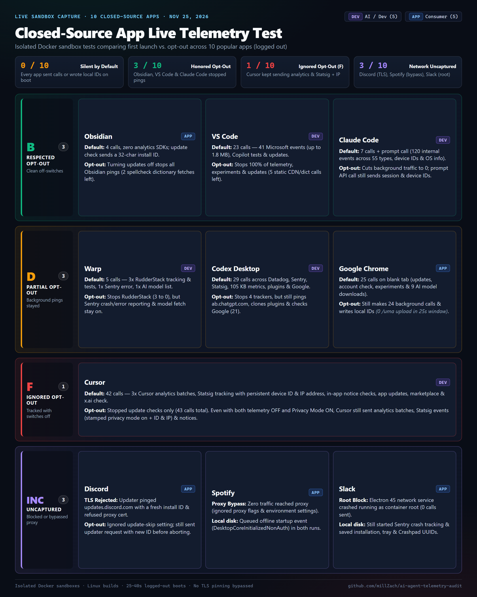

# Closed-Source Desktop App Telemetry Audit (10-App Live Sandbox Study)

A live network and filesystem telemetry capture across **10 popular closed-source apps** (5 AI/developer tools + 5 everyday consumer desktop apps), comparing **default cold boot** vs. **privacy / opt-out settings** inside isolated disposable Docker containers (`ubuntu:24.04` under virtual display `Xvfb`, logged out, Nov 25, 2026).

---

## 1. Why Test in Docker Sandboxes Instead of Directly on a Windows Desktop

Installing and testing closed-source apps directly on a personal Windows PC mixes real user data into telemetry payloads, leaves behind background services, and muddies measurement:

1. **Zero leak of real identity or accounts:** Every app launches against a wiped disposable `$HOME` (`/sandbox/home`) containing no browser cookies, personal files, Windows credentials, or logged-in accounts.
2. **Zero persistent background junk:** Each scenario runs inside a single `--rm` container that disappears on exit, leaving the host free of stray updaters, Electron profiles, crash daemons, and registry keys.
3. **Clean before/after attribution:** A single capture proxy (`mitmproxy`) and `$HOME` filesystem diff (`fs_diff.json`) isolate what one app does during cold boot vs. opt-out without background traffic from unrelated desktop software.
4. **Honest visibility into strict TLS / proxy bypass behavior:** Certificate rejections and proxy-bypass behavior are captured cleanly inside the container instead of weakening host-wide certificate trust.

---

## 2. Ranked Summary Matrix (10 Closed-Source Apps)

All 10 targets ran twice inside clean disposable containers (`25s–40s`, logged out):
- **Scenario 1 (`cold_boot`):** Default configuration on first launch.
- **Scenario 2 (`opt_out`):** Vendor telemetry/update opt-out environment variables or local config files pre-seeded where documented, plus `DO_NOT_TRACK=1` across all targets.

### Tier `B` — Respected Opt-Out (`3 / 10`)

| Rank / App | Category | Version Tested | `cold_boot` Observed Behavior | `opt_out` Applied | `opt_out` Result |
| :--- | :--- | :--- | :--- | :--- | :--- |
| **Obsidian** | Consumer | `1.15.1` | `4` HTTP (GitHub release check + `releases.obsidian.md/desktop?id=<32-hex>&v=1.15.1&p=linux` + `2x` Chrome spellcheck `.bdic`; zero ad/analytics SDKs) | `obsidian.json` (`updateDisabled: true`) + `DO_NOT_TRACK=1` | **Respected (`2` HTTP)** — stopped release and install-ID pings (`0`); only Chrome spellcheck `.bdic` fetched |
| **VS Code** | AI / Dev | `1.148.0` | `23` HTTP (`8x` OneCollector up to `1.8 MB` / `41` events, Copilot experiments `exp.*.githubcopilot.com`, `exp-tas.com`, updater, marketplace) | `settings.json` (`telemetry.telemetryLevel: "off"`, updates & experiments off) + `DO_NOT_TRACK=1` | **Respected (`5` HTTP)** — stopped 100% of OneCollector, Copilot experiments, A/B testing, updater & marketplace calls; only static CDN/dict left |
| **Claude Code** | AI / Dev | `v2.1.332` | `7` HTTP + `1` prompt API call (`120` internal `tengu_*` events across `55` types, GrowthBook `deviceID`/`sessionId`, directory/bootstrap probes, OS info) | Env flags (`CLAUDE_CODE_DISABLE_NONESSENTIAL_TRAFFIC=1`, `DISABLE_TELEMETRY=1`, `DISABLE_ERROR_REPORTING=1`, `DISABLE_AUTOUPDATER=1`, `DO_NOT_TRACK=1`) | **Respected background HTTP (`0` calls)** — telemetry batches, feature flags & updater silenced; prompt API call still attaches session/device IDs & writes `.claude.json` IDs |

### Tier `D` — Partial Opt-Out (`3 / 10`)

| App | Category | Version Tested | `cold_boot` Observed Behavior | `opt_out` Applied | `opt_out` Result |
| :--- | :--- | :--- | :--- | :--- | :--- |
| **Warp** | AI / Dev | `v0.2026.11.18` (`stable_06`) | `5` HTTP (`3x` RudderStack `v1/batch` w/ `ImprovedPaletteSearch` experiment enrollment & startup events, `1x` Sentry dbus error, `1x` `FreeAvailableModels`) | `user_preferences.json` (`TelemetryEnabled: "false"`) + `WARP_TELEMETRY_ENABLED=false` + `DO_NOT_TRACK=1` | **Stopped analytics, kept Sentry (`2` HTTP)** — RudderStack dropped `3 -> 0` (logged disabled); Sentry error report & model fetch still fired; still wrote local `ExperimentId` |
| **Codex Desktop** | AI / Dev | `26.1120.50957` | `29` HTTP (`2x` Datadog logs, `3x` Sentry, `2x` Statsig `/rgstr`, `105 KB` OTLP metrics, `ab.chatgpt.com/v1/initialize`, `openai/plugins.git`, Google checks) | `.codex/config.toml` (`analytics=false`, `feedback=false`, `otel="none"`, `check_for_update_on_startup=false`) + `DO_NOT_TRACK=1` | **Partial opt-out (`21` HTTP)** — stopped Datadog, Sentry, Statsig & OTLP, but **still pinged `ab.chatgpt.com/v1/initialize`**, cloned `plugins.git` & ran Google checks |
| **Google Chrome** | Consumer | `158.0.8127.88` | `25` HTTP (`update.googleapis.com` hardware/update beacons, `ListAccounts`, `chrome-variations/seed`, `async/folae`, OHTTP key, `optimizationguide-pa` `GetModels` + `9x` model downloads); `0` `/uma` uploads in 25s | `Local State` (`reporting_enabled: false`) + `Preferences` (`enable_do_not_track: true`) + `DO_NOT_TRACK=1` | **Background Google services kept running (`24` HTTP)** — `0` `/uma` upload in 25s, but updates, Finch variations seed, `ListAccounts` & AI model fetches all still fired; wrote local `provisional_client_id` |

### Tier `F` — Ignored Opt-Out (`1 / 10`)

| App | Category | Version Tested | `cold_boot` Observed Behavior | `opt_out` Applied | `opt_out` Result |
| :--- | :--- | :--- | :--- | :--- | :--- |
| **Cursor** | AI / Dev | `3.32.4` | `42` HTTP (`3x AnalyticsService/Batch`, `2x BootstrapStatsig`, `2x Statsig /rgstr` w/ `stableID` & IP, `InAppAdService/GetNotices`, updates, marketplace, `status.x.ai`) | `settings.json` (`telemetry.telemetryLevel: "off"`, `cursor.privacyMode: true`, updates & extension auto-checks off) + `DO_NOT_TRACK=1` | **Ignored telemetry opt-out (`43` HTTP)** — stopped updates only; **still sent `3x AnalyticsService/Batch`, `2x BootstrapStatsig`, `3x Statsig /rgstr` (stamped `"isInPrivacyMode": true` + `stableID` & IP), & `InAppAdService/GetNotices`** |

### Tier `INC` — Network Uncaptured / Blocked or Bypassed Proxy (`3 / 10`)

| App | Category | Version Tested | Observed Network Behavior | Local Telemetry State Written | What Happened With Opt-Out |
| :--- | :--- | :--- | :--- | :--- | :--- |
| **Discord** | Consumer | Linux `.deb` bootstrapper | `0` decrypted HTTP — Rust/reqwest updater hit `updates.discord.com/.../manifests/latest?install_id=<uuid>&...` & aborted on proxy CA (`InvalidCertificate(UnknownIssuer)`) | Created `.config/discord/installer.db` (`12,288` bytes) | `SKIP_HOST_UPDATE: true` + `DO_NOT_TRACK=1` **ignored by Rust bootstrapper** — still contacted `updates.discord.com` w/ fresh `install_id` before aborting |
| **Spotify** | Consumer | `1.3.4.258` (`CEF 151`) | `0` proxy HTTP — zero connections/TLS handshakes reached `proxy:8080` (ignored `--proxy-server` & proxy env vars) | Initialized `Segmentation Platform`, `ukm_db`, `Local State`, & queued offline event **`DesktopCoreInitializedNonAuth`** in `.cache/spotify/public.ldb/000003.log` | `DO_NOT_TRACK=1` only — still bypassed proxy and **still queued `DesktopCoreInitializedNonAuth` locally on disk** |
| **Slack** | Consumer | `4.53.292` (Electron `45.3.2`) | `0` outbound HTTP — Electron 45 Chromium `network_service` crashed under container UID `0` (`--no-sandbox` rejected) | Initialized **Sentry** (`session.json` w/ `did`, `sid`, `release: "Slack@4.53.292"`), base64 `installation` & `tray_uuid_v1` UUIDs, `Crashpad/client_id`, `Local State` (`uninstall_metrics`) | `DO_NOT_TRACK=1` only — same local ID & Sentry session initialization before container root network-service failure |

---

## 3. Detailed Per-App Findings

### 1. Claude Code (`v2.1.332`)
- **`cold_boot` (exit `0`, `7` HTTP + `1` prompt API call to mock LLM `/v1/messages?beta=true`):**
  - Sent GrowthBook evaluation `POST api.anthropic.com/api/eval/sdk-zAZezfDKGoZuXXKe` (`200`) carrying `deviceID`, `sessionId`, `apiBaseUrlHost`, and `credentialKind`.
  - Sent `2x POST api.anthropic.com/api/event_logging/v2/batch` (`200`, `13,178` + `231,222` decoded bytes) containing **`120` `ClaudeCodeInternalEvent` records across `55` unique `tengu_*` event names** (e.g. `tengu_managed_settings_os_read`, `tengu_single_word_prompt`, `tengu_cli_flags`, `tengu_dir_search`, `tengu_claudeai_mcp_eligibility`, `tengu_api_query`, `tengu_api_success`), OS info (`linux_distro_id: "ubuntu"`, `linux_kernel`, `deployment_environment: "docker"`), and base64-encoded process memory/CPU metrics.
  - Also called `GET api.anthropic.com/api/directory/server-urls` (`200`), `GET api.anthropic.com/api/claude_code_penguin_mode` (`401`), and `2x GET api.anthropic.com/api/claude_cli/bootstrap` (`401`).
  - `strace` reads: `.claude` (`146`), `.gitconfig` (`21`), `/etc/machine-id` (`1`).
- **`opt_out` (`CLAUDE_CODE_DISABLE_NONESSENTIAL_TRAFFIC=1`, `DISABLE_TELEMETRY=1`, `DISABLE_ERROR_REPORTING=1`, `DISABLE_AUTOUPDATER=1`, `DO_NOT_TRACK=1`):**
  - Exited `0` with **`0` background HTTP calls** (telemetry batches, feature flags, directory/bootstrap probes all stopped).
  - The AI prompt API request still carried `X-Claude-Code-Session-Id` and `metadata.user_id` (with `device_id`) alongside repo/git/branch/prompt inputs, and `.claude.json` still saved `userID` and `machineID`.

### 2. OpenAI Codex Desktop (`26.1120.50957`)
- **`cold_boot` (exit `0`, `29` HTTP, `1` TLS error `persistent.oaistatic.com`):**
  - `2x POST chat.openai.com/ces/v1/telemetry/intake` (`202`, `7,932` & `22,315` bytes Datadog browser logs with `codex.app_session_id`).
  - `POST ab.chatgpt.com/v1/initialize` (`200`, `1,212` bytes).
  - `3x POST o33249.ingest.us.sentry.io/api/4510999349821440/envelope/` (`200`, `sentry.javascript.electron/7.7.1`, `release: "codex@26.1120.50957"`).
  - `2x POST chatgpt.com/ces/v1/rgstr` (`202`, `5,108` & `544` bytes Statsig diagnostics with `stableID`, `systemVersion`, `codex_app_session_id`).
  - `POST ab.chatgpt.com/otlp/v1/metrics` (`200`, `105,550` bytes decoded JSON with `service.name: "codex-app-server"`, `service.version: "0.171.0-alpha.13.2"`, `os_version: "24.4.0"`).
  - Also cloned `github.com/openai/plugins.git` (`6,007` `$HOME` non-cache files) and queried Chrome component/account endpoints (`accounts.google.com/ListAccounts`, `clients2.google.com`, `update.googleapis.com`, `www.google.com/async/folae`, `www.gstatic.com`, `edgedl.me.gvt1.com`).
- **`opt_out` (`.codex/config.toml` disabling analytics, feedback, OTLP metrics, and startup updates + `DO_NOT_TRACK=1`):**
  - Exited `0`, `21` HTTP (`1` TLS error `persistent.oaistatic.com`).
  - Stopped Datadog, Statsig `/rgstr`, Sentry, and OTLP metrics, but **still sent `POST ab.chatgpt.com/v1/initialize` (`1,212` bytes)**, cloned `openai/plugins.git` (`6,004` non-cache files), and performed the Google Chrome background calls.

### 3. Cursor (`3.32.4`)
- **`cold_boot` (exit `0`, `42` HTTP; proxy logs also recorded selective TLS disconnects on `api2.cursor.sh` and `status.x.ai`):**
  - `3x POST api2.cursor.sh/aiserver.v1.AnalyticsService/Batch` (`browser_visibility`, `glass.renderer_launched`, `glass.extension.activated`, `!composer.auto_run_setting_changed`).
  - `2x BootstrapStatsig`, `2x POST api3.cursor.sh/tev1/v1/rgstr` (`statsig::gate_exposure`, `stableID`, `ip`), `InAppAdService/GetNotices`, update check, extensions control, `marketplace.cursorapi.com` / `downloads.cursor.com`, `status.x.ai`, `gvt1.com`, and `401` AI probes.
  - Created `.cache/Microsoft/DeveloperTools/deviceid`, `.config/Cursor/machineid`, and `Crashpad/client_id`.
- **`opt_out` (`telemetry.telemetryLevel: "off"`, `update.mode: "none"`, `extensions.autoCheckUpdates: false`, `cursor.privacyMode: true`, `DO_NOT_TRACK=1`):**
  - Exited `0`, `43` HTTP (`1` TLS error `api2.cursor.sh`).
  - Only `api2.cursor.sh/updates/...` stopped. **Cursor still sent `3x AnalyticsService/Batch`, `2x BootstrapStatsig`, `3x api3.cursor.sh/tev1/v1/rgstr` (explicitly carrying `"isInPrivacyMode": true`, `"stableID"`, and `"ip"`), and `InAppAdService/GetNotices`**, plus extensions, marketplace, `status.x.ai`, `gvt1.com`, and local device/machine IDs.

### 4. Visual Studio Code (`1.148.0`)
- **`cold_boot` (exit `0`, `23` HTTP):**
  - `8x POST mobile.events.data.microsoft.com/OneCollector/1.0` (up to `1,816,867` bytes, `41` events including `monacoworkbench/clientPlatformInfo`, `query-expfeature`, `agentHost.startupMark`, `copilotSdk/session_start`).
  - `POST exp.individual.githubcopilot.com/api/v1/assignments` (`machineId`) & `POST exp.enterprise.githubcopilot.com/api/v1/assignments` (`devdeviceid`), `default.exp-tas.com/vscode/ab`, updater, marketplace, CDN, and `gvt1.com`.
- **`opt_out` (`telemetry.telemetryLevel: "off"`, `update.mode: "none"`, `extensions.autoCheckUpdates: false`, `workbench.enableExperiments: false`, `DO_NOT_TRACK=1`):**
  - Exited `0`, `5` HTTP. **Stopped 100% of OneCollector, Copilot experiments, `exp-tas`, updater, and marketplace traffic**, leaving only Chrome dictionary (`gvt1.com`) and static `main.vscode-cdn.net` manifests (`chat.json`, `marketplace.json`, `core/stable.json`), while still writing local `deviceid`, `machineid`, and `Crashpad/client_id`.

### 5. Warp (`v0.2026.11.18.08.17.stable_06`)
- **`cold_boot` (exit `0`, `5` HTTP):**
  - `1x POST o540343.ingest.sentry.io/api/5658526/envelope/` (fired on container `unknown dbus error`, sending `anon.<uuid>`, container hostname `server_name`, OS/kernel, and loaded library list).
  - `3x POST warpianwzlfqdq.dataplane.rudderstack.com/v1/batch` (`200`: `experiments.client.enroll_client` for `ImprovedPaletteSearch`, `Logged-out App Startup`, and `App Download Source`, with `anonymousId`, Amplitude `session_id`, and `x-warp-*` OS headers).
  - `1x POST app.warp.dev/graphql/v2?op=FreeAvailableModels` (`200`).
  - Created `.config/warp-terminal/user_preferences.json` containing `ExperimentId`, plus `warp.log` & `warp.sqlite*`.
- **`opt_out` (`prefs.TelemetryEnabled = "false"` in `user_preferences.json` + `WARP_TELEMETRY_ENABLED=false` + `DO_NOT_TRACK=1`):**
  - Exited `0`, `2` HTTP. `warp.log` explicitly logged `Not sending telemetry event because telemetry is disabled.` and RudderStack dropped `3 -> 0`.
  - **Sentry crash/error reporting (`1x`) still fired** on the startup dbus error (`anon.<uuid>`), `FreeAvailableModels` (`1x`) still fetched model metadata, and `user_preferences.json` still wrote a local `ExperimentId`.

### 6. Obsidian (`1.15.1`)
- **`cold_boot` (exit `0`, `4` HTTP):**
  - Downloaded Chromium spellcheck dictionary (`redirector.gvt1.com` -> `.bdic`), checked GitHub (`raw.githubusercontent.com/obsidianmd/obsidian-releases/master/desktop-releases.json`), and queried `GET https://releases.obsidian.md/desktop?id=<32-hex>&v=1.15.1&p=linux` (`200`), sending the freshly generated 32-hex install ID from `.config/obsidian/id` alongside version and OS. Zero third-party analytics SDKs observed; wrote `Crashpad/client_id` and Chromium `Local State` (`uninstall_metrics`).
- **`opt_out` (`updateDisabled: true` in `.config/obsidian/obsidian.json` + `DO_NOT_TRACK=1`):**
  - Exited `0`, `2` HTTP. Logged `Updates disabled.` and suppressed both update requests (including the `releases.obsidian.md/desktop?id=...` ping), leaving only the 2 Chrome `.bdic` dictionary requests.

### 7. Discord (Linux `.deb` Bootstrapper)
- **`cold_boot` & `opt_out` (`SKIP_HOST_UPDATE: true` in `.config/discord/settings.json` + `DO_NOT_TRACK=1`):**
  - Wrapper exited `0`; `0` decrypted HTTP records, and `.config/discord/installer.db` (`12,288` bytes) was created.
  - Container stdout and proxy logs confirmed Discord's Rust/reqwest bootstrapper attempted `https://updates.discord.com/distributions/app/manifests/latest?install_id=<uuid>&channel=stable&platform=linux&arch=x64&platform_version=24.4.0`, rejected the monitoring CA (`InvalidCertificate(UnknownIssuer)` / `tlsv1 alert unknown ca`), and aborted before launching the Electron UI. Even with `SKIP_HOST_UPDATE: true`, the native bootstrapper still contacted `updates.discord.com` with a fresh `install_id`.

### 8. Slack (`4.53.292` / Electron `45.3.2`)
- **`cold_boot` & `opt_out` (`DO_NOT_TRACK=1` only):**
  - Wrapper exited `0`; `0` outbound HTTP requests reached the proxy because Electron 45's Chromium `network_service` child process repeatedly exited with `FATAL:electron/shell/app/electron_main_delegate.cc:224] Running as root without --no-sandbox is not supported`.
  - Before network egress failed, Slack still initialized Sentry (`Starting Sentry`, writing `.config/Slack/sentry/session.json` with `did`, `sid`, `release: "Slack@4.53.292"` in `opt_out`), base64 UUIDs in `.config/Slack/installation` and `tray_uuid_v1`, `Crashpad/client_id`, `Local State` (`uninstall_metrics`), and `declarative_performance_observer.db`.

### 9. Spotify (`1.3.4.258.gc60b10b0946a` / CEF `151.0.7922.138`)
- **`cold_boot` & `opt_out` (`DO_NOT_TRACK=1` only):**
  - Ran cleanly for 25s (`exit 0`); `0` requests or TLS handshakes reached `proxy:8080`, demonstrating Spotify's Linux client ignored `--proxy-server` and proxy environment variables.
  - Locally, under **both** `cold_boot` and `opt_out`, Spotify initialized Chromium `Local State`, `Segmentation Platform`, `ukm_db`, `ServerCertificate`, `BrowserMetrics`, and queued an offline telemetry event **`DesktopCoreInitializedNonAuth`** (alongside `es#installation-data` and `es#rec_id`) into `.cache/spotify/public.ldb/000003.log` (`958` bytes).

### 10. Google Chrome (`158.0.8127.88` Linux)
- **`cold_boot` (exit `0`, `25` HTTP; blank `about:blank` + `--no-first-run` + `--no-default-browser-check`):**
  - Contacted Google infrastructure on boot: `clients2.google.com/time/1/current`, `clients2.google.com/service/update2/crx`, `POST accounts.google.com/ListAccounts`, `www.gstatic.com/ohttp_gateway/hpke_public_keys/v1/sbc_prod`, `2x POST update.googleapis.com/service/update2/json` (sending RAM size, CPU flags `avx/sse*`, Linux kernel version, `requestid`, `sessionid`, and component update telemetry), `clientservices.googleapis.com/chrome-variations/seed`, `2x www.google.com/async/folae`, `.bdic`/`.crx` downloads, and `POST optimizationguide-pa.googleapis.com/v1:GetModels` + `9x` model/segmentation downloads.
  - Proxy logs also recorded selective TLS disconnects on `optimizationguide-pa.googleapis.com`, `clientservices.googleapis.com`, and `www.gstatic.com` from strict-pinned subcomponents. Zero `clientservices.googleapis.com/uma` uploads fired within the 25s logged-out window, while `Local State` wrote `provisional_client_id`, `limited_entropy_randomization_source`, `low_entropy_source3`, and `uninstall_metrics`.
- **`opt_out` (`Local State`: `user_experience_metrics.reporting_enabled: false`, `Default/Preferences`: `enable_do_not_track: true`, `DO_NOT_TRACK=1`):**
  - Exited `0`, `24` HTTP. **All update beacons, `ListAccounts`, Finch variations seed, OHTTP key fetch, `async/folae`, and Optimization Guide model calls still fired**, and `Local State` still generated `provisional_client_id` and `limited_entropy_randomization_source`.

---

## 4. Honest Methodology Caveats

- **Logged-out fresh boots (`25s–40s`):** No user accounts were signed in and no workspaces, channels, or web pages were opened; signed-in telemetry and periodic delayed uploads (such as Chrome `/uma` uploads) are not exercised.
- **Linux desktop packages in `Xvfb` containers:** Windows/macOS installers can ship platform-specific updaters or crash handlers, and Slack's Chromium `network_service` refused UID `0` inside the container.
- **No TLS pinning bypasses:** Discord's Rust updater refused the proxy certificate cleanly and Spotify bypassed `HTTP_PROXY`/`--proxy-server`; neither security boundary was altered.
